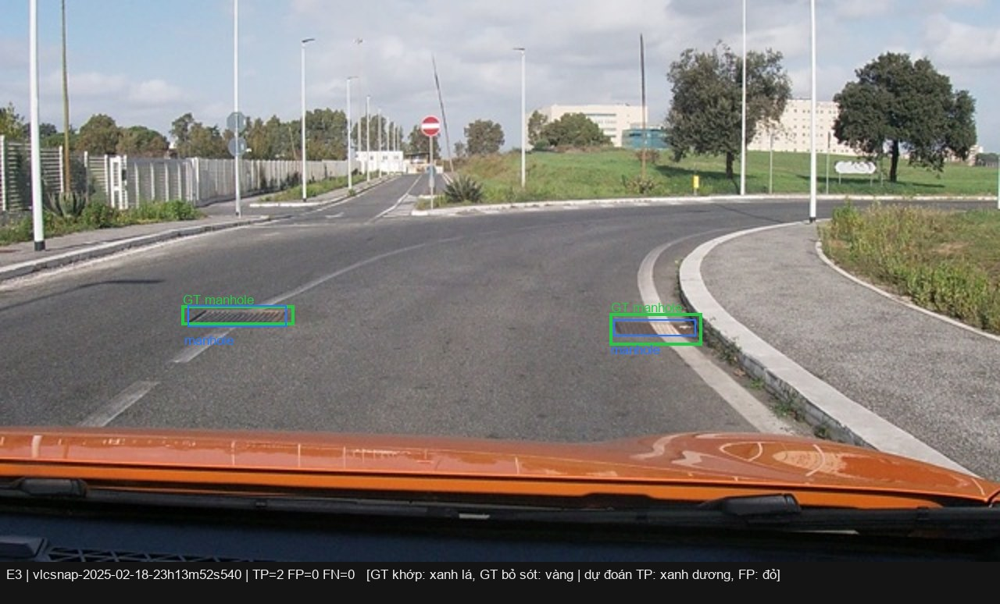
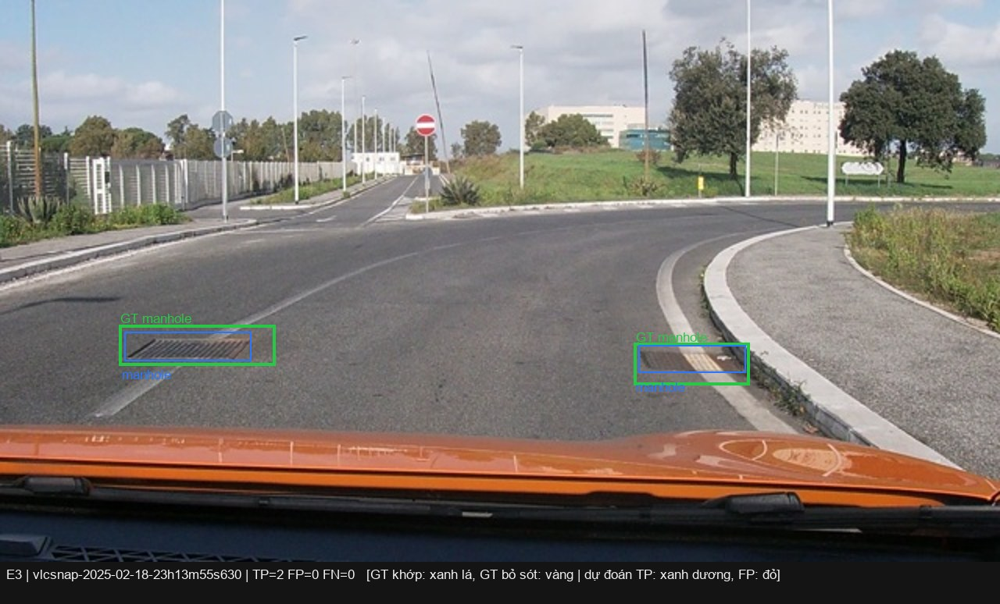
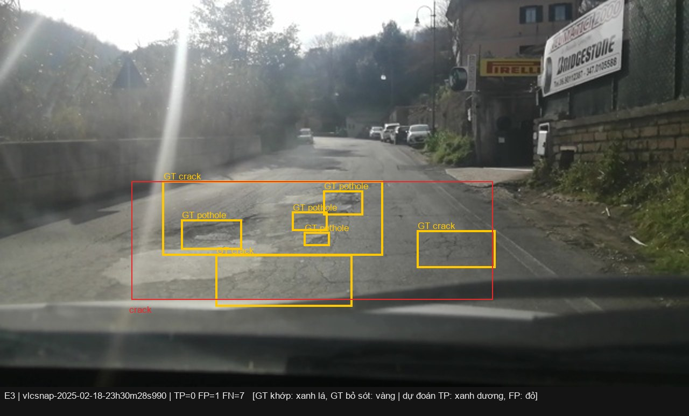
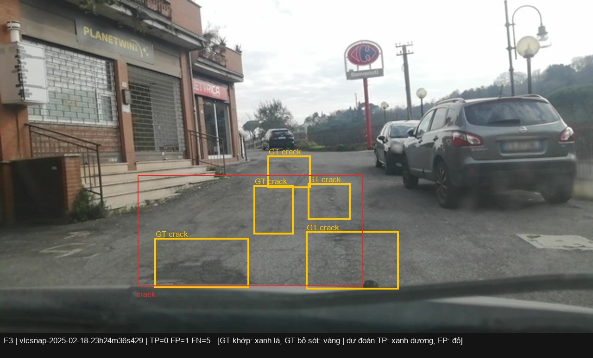
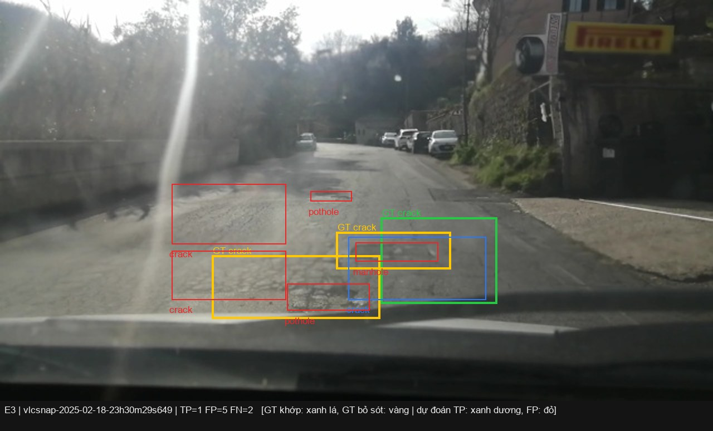
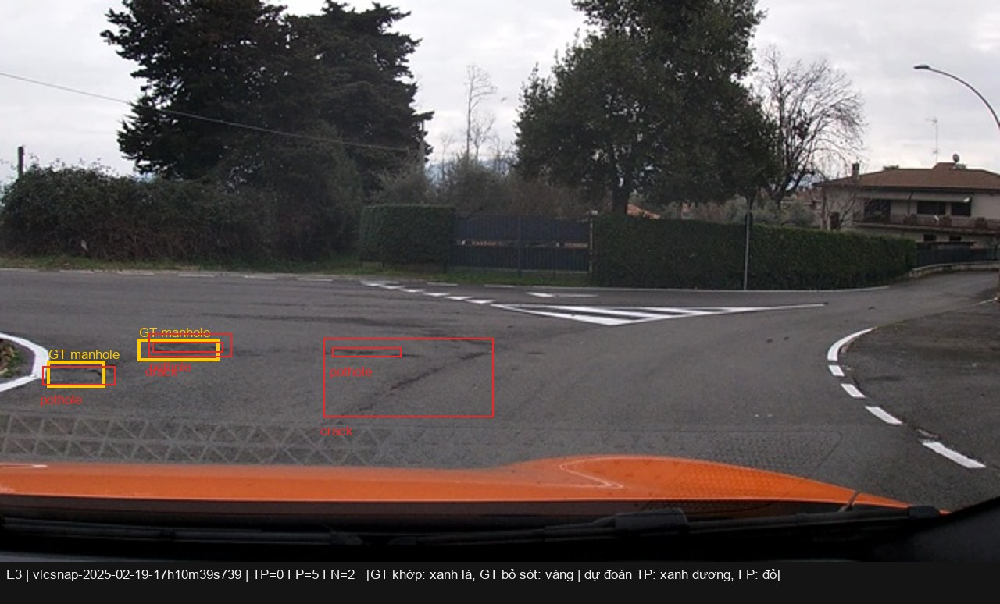
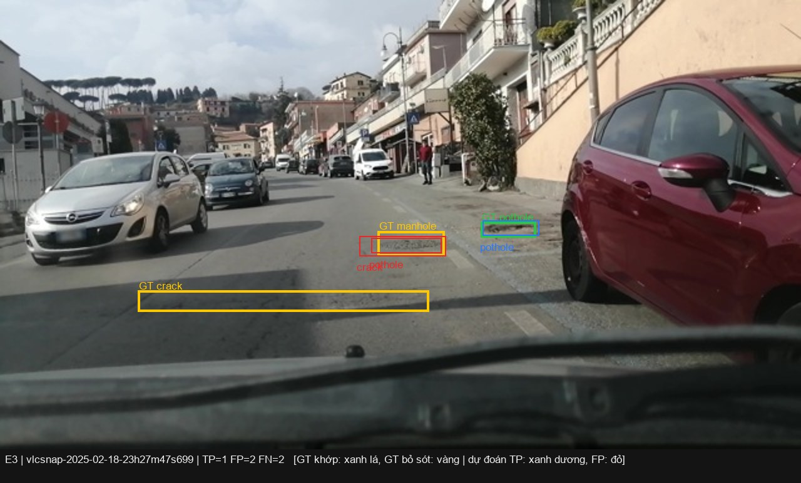
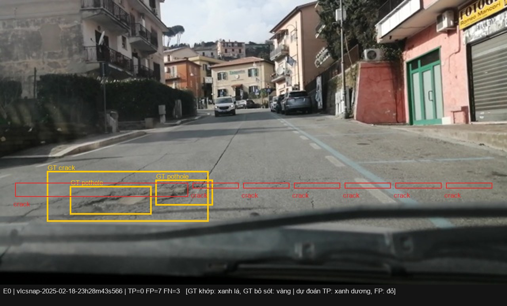
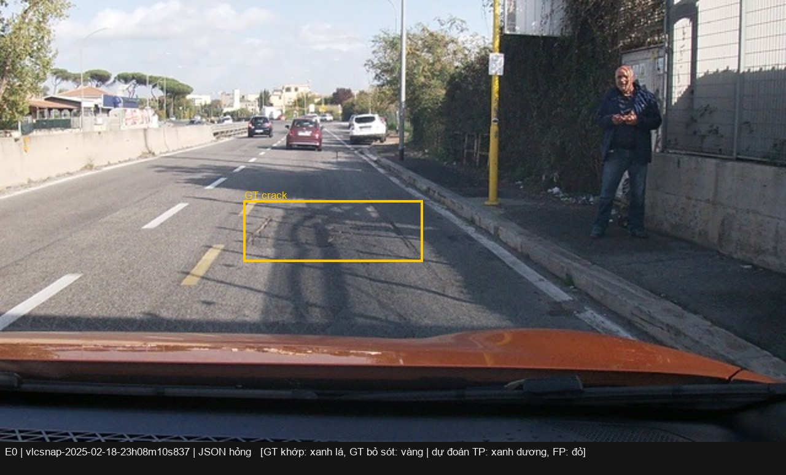

Họ tên: Phạm Quang Huy
`dataset_version`: d10-21e4070301

> Mọi số dưới đây lấy từ `report/evidence/*.json` (sinh bởi `scripts/score.py`), `report/runs/*/run.json`
> (log huấn luyện) và `report/analysis/` (`python -m lab.analysis`, `python -m lab.leakage`). Phần cứng: **Kaggle
> Tesla T4 16 GB** (máy T4 x2, mỗi thí nghiệm chiếm riêng một GPU, chạy bằng `kaggle_jobs/build.py`); log thật trong
> `report/logs/`. Phiên bản: torch 2.11.0+cu128, transformers 5.19.0, peft 0.21.2, trl 1.9.2, bitsandbytes 0.50.2.
> Các bẫy kỹ thuật đã gặp: [`BAO_CAO_LOI_VA_LUU_Y.md`](BAO_CAO_LOI_VA_LUU_Y.md).

## Bảng tổng hợp (số của bạn, lấy từ `report/evidence/*.json`)

VRAM đỉnh = `torch.cuda.max_memory_allocated` lúc huấn luyện (GiB); Phút = thời gian vòng huấn luyện 300 bước
(không gồm nạp model và suy luận). CI95 = bootstrap theo ảnh của `score.py` (1.000 lần).

| Mã | Setup | Tham số huấn luyện | VRAM đỉnh (GB) | Phút | F1 | CI95 | FP/ảnh | F1 pothole | F1 crack | F1 manhole |
|---|---|---|---|---|---|---|---|---|---|---|
| E0 | zero-shot | 0 | – | – | 0.101 | [0.074, 0.131] | 0.86 | 0.121 | 0.033 | 0.222 |
| E1 | LoRA LLM | 33,030,144 | 6.49 | 42.97 | 0.268 | [0.232, 0.309] | 1.28 | 0.113 | 0.217 | 0.529 |
| E2 | + projector | 142,135,296 | 8.18 | 43.88 | 0.313 | [0.276, 0.353] | 1.20 | 0.167 | 0.239 | 0.589 |
| E3 | + LoRA ViT | 148,426,752 | 8.35 | 51.78 | 0.429 | [0.389, 0.469] | 0.87 | 0.316 | 0.337 | 0.702 |
| E4 | E3, `coord_scale=norm1000` (chính run E3) | 148,426,752 | 8.35 | 51.78 | 0.429 | [0.389, 0.469] | 0.87 | 0.316 | 0.337 | 0.702 |
| E4 | E3, `coord_scale=pixel` | 148,426,752 | 8.35 | 55.91 | 0.363 | [0.323, 0.407] | 1.08 | 0.241 | 0.288 | 0.608 |
| E5 | GRPO từ E3, 60 bước | 39,321,600 | 7.47 | 46.29 | 0.448 | [0.407, 0.488] | 0.72 | 0.336 | 0.362 | 0.690 |

Thêm (cùng nguồn): precision / recall / `parse_valid_rate` / mean IoU của cặp khớp — E0 0.144 / 0.077 / 0.907 / 0.614;
E1 0.276 / 0.261 / 0.994 / 0.681; E2 0.322 / 0.304 / 1.000 / 0.674; E3 0.462 / 0.400 / 1.000 / 0.700;
E4-pixel 0.378 / 0.350 / 0.997 / 0.688; E5 0.509 / 0.400 / 1.000 / 0.697. Thí nghiệm đối chứng ngoài rubric (câu 4):
E1 không mask loss, F1 0.255 [0.219, 0.292] (`report/extra/nomask_e1.json`). Với E5, "Tham số huấn luyện" chỉ gồm
LoRA, vì projector của E3 được giữ đóng băng; "Phút" là thời gian 60 bước GRPO.
Bảng đầy đủ (gồm cả P, R, valid, mean IoU): `report/analysis/table.md`. Biểu đồ: `report/figures/f1_ci95.png`,
`report/figures/loss_e1_e3.png`.

## 10 câu hỏi (trả lời bằng **số của bạn**, không chép lại tài liệu)

### Câu 1 — Kiến trúc: ViT, projector và LLM của Qwen3-VL-4B có bao nhiêu tham số mỗi khối, và E1/E2/E3 mỗi cái cập nhật khối nào?

Tôi đếm bằng `model.named_parameters()` trên model thật (`python -m lab.inspect_model`, kết quả ở
`report/analysis/inspect_model.json`; tham số `Params4bit` được nhân 2 vì 2 trọng số 4-bit đóng gói trong 1 byte):

| Khối | Module | Tham số |
|---|---|---|
| ViT | `model.visual.patch_embed` + `pos_embed` + 24 `blocks` | 306,242,560 |
| Projector | `model.visual.merger` | 27,271,680 |
| Projector (DeepStack) | `model.visual.deepstack_merger_list` (3 merger lấy đặc trưng ViT lớp 5, 11, 17) | 81,833,472 |
| LLM | `model.language_model.embed_tokens` | 388,956,160 |
| LLM | 36 `layers` + `norm` | 3,633,511,936 |
| `lm_head` | dùng chung trọng số với `embed_tokens` (`tie_word_embeddings=True`) | 0 thêm |
| **Tổng** | | **4,437,815,808** |

Tức ViT ≈ 306M (415M nếu tính cả projector nằm trong `model.visual`), projector ≈ 109,1M, LLM ≈ 4,02B. Sau khi nạp:
`language_model.*.q_proj` là `Linear4bit` (NF4), còn `visual.blocks.0.attn.qkv`, `visual.merger.linear_fc1`, `lm_head`
là `float16`; model chiếm 3,24 GB VRAM.

- **E1** cập nhật **chỉ LLM** qua LoRA r=16, α=32 trên 252 module (36 lớp × `q,k,v,o,gate,up,down_proj`):
  33,030,144 tham số (0,74% model). ViT và projector đóng băng.
- **E2** = E1 + **mở toàn bộ projector** (`visual.merger` + `visual.deepstack_merger_list`, 24 tensor, 109,105,152 tham
  số, huấn luyện ở fp32): 142,135,296 tham số (3,20%).
- **E3** = E2 + **LoRA trên ViT**: 96 module (24 block × `attn.qkv`, `attn.proj`, `mlp.linear_fc1`, `mlp.linear_fc2`),
  thêm 6,291,456 tham số → 148,426,752 (3,34%). Tổng cộng 348 module LoRA. Thân ViT vẫn đóng băng, chỉ adapter học.

### Câu 2 — E0: `parse_valid_rate` bằng bao nhiêu, và hai lỗi phổ biến nhất của model gốc là gì (kèm một ví dụ output thô)?

`parse_valid_rate` của E0 = **0,907** (282/311 ảnh). Model gốc **không** bọc ```` ```json ```` (0/311) và không thêm câu
chữ: nó tuân thủ định dạng. 29 ảnh hỏng là do: **25 ảnh bị cắt ở `max_new_tokens=256`** vì model rơi vào vòng lặp
"lát gạch" các box crack liền nhau, ví dụ (`vlcsnap-2025-02-18-23h08m18s609`):
`[{"label": "crack", "bbox_2d": [407, 420, 475, 470]}, {"label": "crack", "bbox_2d": [475, 420, 530, 470]}, {"label": "crack", "bbox_2d": [530, 420, 585, 470]}, … [640, 420, 695, 4` (bị cắt giữa số);
và 4 ảnh JSON sai cú pháp, ví dụ `[295, 478, 357, 500)}]`.

Hai lỗi phổ biến nhất (phân loại bằng `lab.analysis.error_breakdown` trên 311 ảnh test):

1. **Bịa box / sai vị trí (FP)**: 312 box dự đoán thì 267 là FP (precision 0,144). Trong đó 148 box "bịa" (IoU < 0,1
   với mọi box đúng cùng lớp) và 117 box sai vị trí (0,1 ≤ IoU < 0,5); chỉ 2 box sai lớp. Kiểu điển hình là một **dải
   "crack" kéo ngang hết khung hình**: 55 box rộng ≥ 90% chiều ngang trên 54 ảnh. Ví dụ `vlcsnap-00208`: output thô
   `[{"label": "crack", "bbox_2d": [0, 654, 1000, 829]}]` trong khi box đúng là crack `[450, 622, 766, 806]`.
2. **Bỏ sót (FN)**: recall chỉ 0,077. Model trả trung bình 1,00 box/ảnh trong khi ảnh test có 1,87 box/ảnh; 414/538 box
   đúng bị bỏ sót hoàn toàn (không có dự đoán nào IoU ≥ 0,1), và 14 ảnh trả `[]` dù **không ảnh test nào rỗng**. Lớp
   crack gần như không tìm được (F1 0,033).

Model gốc **không** sai thang: toạ độ của nó đúng là 0–1000 (chấm cùng file dự đoán theo pixel cho F1 = 0,000, xem
câu 3). Ảnh minh hoạ: `report/figures/e0_*.jpg`.

### Câu 3 — Thang 0–1000: nếu chấm output theo pixel (hoặc ngược lại) thì F1 ra sao và vì sao? Bạn đã kiểm chứng điều này thế nào?

F1 về **đúng 0,000** ở cả hai chiều. Tôi chấm lại **cùng một file dự đoán** bằng `scripts/score.evaluate` nhưng khai
báo sai thang (`lab.analysis`, mục `wrong_scale` trong `report/analysis/analysis.json`):

| File dự đoán | Thang thật | Chấm đúng thang | Chấm sai thang | Box có IoU ≥ 0,5 với box đúng cùng lớp (đúng → sai thang) |
|---|---|---|---|---|
| E0 (`report/preds/e0.jsonl`) | 0–1000 | F1 0,101 | **0,000** (coi là pixel) | – |
| E3 (`report/preds/e3.jsonl`) | 0–1000 | F1 0,429 | **0,000** (coi là pixel) | 233/504 → **0/504** |
| E4-pixel (`report/preds/e4_coord_pixel.jsonl`) | pixel | F1 0,363 | **0,000** (coi là 0–1000) | 205/540 → **0/540** |

Vì sao về 0 hẳn chứ không chỉ giảm: ảnh là 640×360 nên hai thang lệch nhau theo **hai hệ số khác nhau**, ×1,5625 theo
x và **×2,78 theo y**. Hư hại nằm ở nửa dưới khung hình (mặt đường). Khi số 0–1000 bị đọc như pixel, toạ độ y ≥ 360
của mọi box biến thành > 1000: **100% trong 504 box của E3 lọt ra ngoài ảnh** và không box nào còn giao với box đúng
(IoU > 0 = 0/504). Chiều ngược lại, khi số pixel bị đọc như 0–1000, box co lại 0,64 lần theo x và 0,36 lần theo y, dồn
hết vào 32% phía trên ảnh (y ≤ 318, tức vùng trời và đường xa), cũng không box nào chạm box đúng (0/540). Với
IoU ≥ 0,5 thì chỉ cần dịch nửa kích thước box là trượt, nên sai thang là phá huỷ hoàn toàn chứ không phải giảm vài %.

Cách tôi kiểm chứng: (1) test `yolo_to_box` ↔ pixel quy đổi khứ hồi sai số ≤ 0,32 px; (2) bảng trên, chấm chéo cùng
file; (3) chạy E4 thật với `coord_scale=pixel`. Model này học đúng thang mới: 540 box có x2 tối đa 640 và y2 tối đa
318, không box nào vượt 640×360, nên `--coord` của `infer.py` và `score.py` phải đi cùng nhau. Đó là lý do mọi bằng
chứng ghi trường `coord` và `lab.analysis` đọc trường này trước khi chấm. Bài học thực tế: nếu F1 bằng 0 tròn trên
một model đã finetune thì nên nghĩ ngay đến lệch thang toạ độ trước khi nghi model.

### Câu 4 — Mask loss: vì sao chỉ tính loss trên phần trả lời? Điều gì xảy ra nếu tính trên cả prompt và token ảnh?

Chuỗi huấn luyện của một ảnh 640×360 gồm **220 token ảnh** (`image_grid_thw = [1, 22, 40]`: ảnh được resize về
640×352, patch 16 px → 22×40 = 880 patch, gộp 2×2 → 220), **136 token** khung chat + prompt, rồi mới đến đáp án.
Đáp án trung bình chỉ 70 token ở train (54 ở test), nên phần cần học chỉ chiếm ≈ 16% chuỗi. Trong ví dụ kiểm tra
(9 box) chuỗi dài 605 token, chỉ 249 token có `labels != -100` và giải mã đúng ra JSON đáp án + `<|im_end|>`
(`report/analysis/inspect_model.json`). Đo trực tiếp trong vòng huấn luyện (trường `tokens` / `supervised_tokens` mỗi
bước trong `train_log.jsonl`, 300 bước × 8 mẫu): chuỗi trung bình **426,6 token/mẫu**. Khi có mask chỉ **70,3 token
(16,5%)** được tính loss (`report/runs/e4_coord_pixel/train_log.jsonl`), còn khi không mask thì cả 426,6 token (100%)
đều được tính (`report/runs/nomask_e1/train_log.jsonl`).

Vì sao chỉ học phần trả lời: mục tiêu là p(đáp án | ảnh, prompt). Prompt **giống hệt nhau** ở mọi mẫu, còn 220 token
ảnh đều là cùng một id giữ chỗ `<|image_pad|>` (nội dung ảnh đi vào qua embedding của ViT thay cho embedding của token
này), nên dự đoán chúng không dạy gì về ổ gà. Nếu tính loss trên cả chuỗi: (1) 83,5% số hạng loss không thuộc đáp án,
nên gradient của phần đáp án bị pha loãng khoảng 6 lần (70,3 / 426,6); (2) một phần dung lượng LoRA bị dùng vào các
token vô nghĩa đó; (3) giá trị loss không còn phản ánh chất lượng đáp án, nên không dùng để theo dõi huấn luyện được.
Trước khi chạy tôi đoán loss sẽ **thấp giả** vì prompt cố định rất dễ thuộc. Thực tế lại ngược lại (bảng dưới).

**Kiểm chứng bằng số:** tôi huấn luyện lại E1 y hệt (300 bước, cùng seed, lr, LoRA) nhưng **không mask**
(`lab.train --no-mask-prompt`, bằng chứng `report/extra/nomask_e1.json`, `report/runs/nomask_e1/`):

| | E1 (mask, chuẩn) | E1 không mask | Ghi chú |
|---|---|---|---|
| F1 (CI95) | 0,268 [0,232; 0,309] | 0,255 [0,219; 0,292] | Δ cặp **−0,013 [−0,045; +0,015]** |
| Precision / Recall | 0,276 / 0,261 | 0,240 / 0,273 | precision giảm, recall nhích lên |
| FP/ảnh | 1,28 | **1,62** | |
| Box dự đoán/ảnh (box đúng: 1,87) | 1,77 | **2,13** | dự đoán thừa box |
| FP "bịa" (IoU < 0,1 với mọi box đúng) | 208 | **302** | |
| F1 pothole / crack / manhole | 0,113 / 0,217 / 0,529 | 0,206 / 0,178 / 0,534 | |
| `parse_valid_rate` | 0,994 | 0,987 | |
| Loss TB 10 bước đầu → 10 bước cuối | 1,27 → 0,59 | 11,56 → **4,14** | không so sánh trực tiếp được |
| Token tính loss / mẫu | ≈ 70 | 426,6 | |

Kết quả:

- **F1 giảm nhẹ nhưng không có ý nghĩa thống kê.** CI cặp chứa 0, và 80% số lần bootstrap bản không mask không hơn bản
  chuẩn. Với 300 bước và một seed, tôi không chứng minh được việc bỏ mask làm F1 tụt. Nói thẳng: thí nghiệm này **không**
  cho thấy thảm hoạ.
- **Hành vi thì đổi rõ.** Model không mask sinh **nhiều box hơn cả số box thật** (2,13 so với 1,87 mỗi ảnh), số box bịa
  tăng 45% (208 → 302), nên FP/ảnh tăng từ 1,28 lên 1,62. F1 pothole tăng nhưng crack giảm, tức chất lượng bị phân bổ
  lại chứ không tốt lên đều.
- **Loss mất ý nghĩa.** Ước lượng thô: phần đáp án chỉ chiếm khoảng 0,6 × 70 ≈ 41 nat/mẫu trong tổng 4,14 × 426,6 ≈
  1.765 nat/mẫu. Prompt cố định thì học thuộc nhanh. Vậy phần lớn loss còn lại nằm ở 220 vị trí `<|image_pad|>`,
  khoảng 7–8 nat/token. Model gần như không thể đoán ra id giữ chỗ này, vì đầu vào ở các vị trí đó là đặc trưng ViT và
  hàng của `<|image_pad|>` trong `lm_head` (dùng chung với `embed_tokens`) chưa từng được huấn luyện làm token đầu ra.
  Hệ quả là phần lớn gradient đi vào đuổi theo một mục tiêu vô ích, và đường loss không cho biết đáp án có tốt lên hay
  không.

**Kết luận:** mask loss là lựa chọn đúng. Lý do chính là tín hiệu học sạch (chỉ học điều ta cần) và đường loss đọc
được, còn F1 mất bao nhiêu trong ngân sách 300 bước thì nhỏ hơn tôi nghĩ và nằm trong nhiễu.

### Câu 5 — Vì sao không thể huấn luyện đầy đủ projector nếu ViT bị lượng tử hoá 4-bit, và bạn đã xử lý thế nào? Vì sao projector phải ở float32?

Khi bị lượng tử hoá, mỗi `nn.Linear` của merger thành `bnb.Linear4bit`: trọng số lưu trong `Params4bit` dạng `uint8`
(2 giá trị NF4 đóng gói trong 1 byte) cộng hằng số tỉ lệ theo khối 64 phần tử, và chỉ được giải nén ra fp16 khi
forward. Tensor số nguyên này **không có gradient và optimizer không cập nhật được**: ta chỉ có thể gắn thêm LoRA bên
cạnh chứ không thể "mở toàn bộ" 109M tham số như E2 yêu cầu. Kể cả có cập nhật được thì mỗi lần lượng tử hoá lại cũng
nuốt mất bước cập nhật nhỏ vì NF4 chỉ có 16 mức.

**Tôi đã gặp đúng lỗi này dù làm theo GUIDE**: với transformers 5.19, `llm_int8_skip_modules=["visual", "lm_head"]`
không giữ được ViT, vì tên module đầy đủ là `model.visual.…` và transformers so khớp mẫu từ **đầu** tên. Smoke test cho
thấy `visual.merger.linear_fc1` có dtype `uint8`, chỉ đếm được 54,579,200 "tham số projector" (một nửa 109,105,152 do
đóng gói) và E3 dừng với `ValueError: Attempting to unscale FP16 gradients`. Cách xử lý: dùng
`llm_int8_skip_modules=["model.visual", "visual", "lm_head"]` và thêm `assert_vit_not_quantized()` (`lab/common.py`)
để dừng ngay nếu còn `Linear4bit` trong ViT hoặc `lm_head`. Sau khi sửa, projector đếm đủ 109,105,152 tham số, và
`lab.check_reload` xác nhận `projector.pt` (24 tensor) khác bản gốc rồi được nạp lại đúng lúc suy luận.

Vì sao **float32**: (1) `GradScaler.unscale_` từ chối gradient fp16 (đúng lỗi ở trên), nên mọi tham số học phải là
fp32 (`apply_setup` ép cả LoRA và projector về fp32). (2) fp16 chỉ có 10 bit mantissa: với trọng số cỡ 0,03, khoảng
cách giữa hai số fp16 liền kề ≈ 3·10⁻⁵, nên bước cập nhật lr·g nhỏ hơn mức đó sẽ bị **làm tròn về 0** và trọng số không
đổi. Giữ "master weight" fp32 thì các bước nhỏ được cộng dồn. Giá phải trả đo được: VRAM đỉnh E2 − E1 = 8,18 − 6,49 =
**+1,69 GiB**, khớp ước lượng 109,1M × 14 byte (+2 byte nâng fp16→fp32, 4 byte gradient, 8 byte trạng thái Adam)
≈ 1,42 GiB, cộng thêm activation/gradient trung gian qua projector.

### Câu 6 — Split theo phiên quay: vì sao chia ngẫu nhiên sẽ cho F1 cao giả? Số ảnh và số box từng lớp ở mỗi split là bao nhiêu?

| Split | Ảnh | Phiên quay | pothole | crack | manhole | Diện tích box trung vị |
|---|---|---|---|---|---|---|
| train | 1,422 | 13 | 1,074 | 1,750 | 691 | 0,64% khung hình |
| val | 276 | 2 | 66 | 470 | 103 | 1,01% |
| test | 311 | 3 (213 + 83 + 15 ảnh) | 121 | 299 | 163 | 1,06% |

Không phiên nào nằm ở hai split (`report/figures/data_stats.json`), không ảnh nào rỗng, và
`dataset_version = d10-21e4070301`.

Ảnh là frame cắt từ video dashcam: hai frame liền kề cách nhau khoảng 1 giây, cùng đoạn đường, cùng ánh sáng, cùng ổ gà.
Nếu chia ngẫu nhiên, gần như mỗi ảnh test đều có "anh em sinh đôi" trong train, nên model chỉ cần **nhớ cảnh** thay vì
học nhận ra hư hại → F1 trên test đo khả năng nhớ, không đo khả năng tổng quát hoá sang đường mới.

**Tôi đo hiện tượng này bằng một baseline không học gì** (`python -m lab.leakage`, `report/analysis/leakage.json`):
với mỗi ảnh test, tìm ảnh train giống nhất (ảnh xám 64×36, khoảng cách L2) rồi **chép nguyên box của nó** làm dự đoán,
chấm bằng chính `scripts/score.evaluate`:

| Cách chia | Láng giềng gần nhất cùng phiên | Láng giềng "gần trùng"* | F1 của baseline chép nhãn |
|---|---|---|---|
| Theo phiên (chuẩn của đề) | 0% | 1,0% | **0,003** [0,000; 0,008] |
| Ngẫu nhiên (cùng kích thước 1.422/311, 5 seed) | 84–85% | 31–38% | **0,077–0,105** (TB 0,091) |

\* khoảng cách nhỏ hơn phân vị 25% khoảng cách giữa hai frame liền kề trong cùng phiên.

Một thuật toán **không hề nhìn thấy ổ gà** tăng F1 gấp khoảng 30 lần chỉ nhờ đổi cách chia, lên ngang E0 zero-shot của Qwen3-VL
(0,101). Baseline này chỉ chép box. Một VLM được finetune trên frame liền kề còn ghi nhớ được cả cảnh, nên mức thổi phồng
với E1–E3 sẽ lớn hơn nữa. Vì thế split theo phiên là điều kiện để con số F1 có nghĩa. Cái giá là phân bố lớp
lệch giữa các split (val chỉ có 66 pothole) và test chỉ gồm 3 phiên (xem câu 8).

### Câu 7 — So sánh E1/E2/E3: mở projector và LoRA trên ViT có đáng không (F1, CI95, VRAM, thời gian)?

| | F1 (CI95) | ΔF1 so với bước trước, CI95 bootstrap **cặp** | VRAM đỉnh | Phút huấn luyện |
|---|---|---|---|---|
| E1 | 0,268 [0,232; 0,309] | +0,168 [+0,130; +0,205] so với E0 | 6,49 GiB | 42,97 |
| E2 | 0,313 [0,276; 0,353] | +0,044 [+0,007; +0,081] so với E1 | 8,18 GiB (+1,69) | 43,88 (+0,9) |
| E3 | 0,429 [0,389; 0,469] | +0,116 [+0,076; +0,156] so với E2 | 8,35 GiB (+0,17) | 51,78 (+7,9) |

Bootstrap cặp (`lab.analysis.paired_bootstrap`, 2.000 lần) lấy lại **cùng một tập ảnh** cho cả hai setup nên loại được
phương sai do "độ khó của ảnh", chặt hơn việc so hai CI riêng (hai CI riêng của E1 và E2 chồng nhau).

- **Mở projector (E2)**: +0,044 F1, CI cặp vừa đủ không chứa 0 (bootstrap: 1,25% lần lấy mẫu E2 không hơn E1). Lợi
  ích có nhưng nhỏ, đổi lại +1,69 GiB VRAM và file `projector.pt` 436 MB phải lưu riêng. FP/ảnh gần như không đổi
  (1,28 → 1,20).
- **LoRA trên ViT (E3)**: bước nhảy lớn nhất, +0,116 so với E2 và +0,160 [+0,120; +0,203] so với E1. Cái giá rất rẻ:
  chỉ +6,3M tham số, +0,17 GiB VRAM và +8 phút (+18%) vì gradient phải đi ngược qua 24 block ViT. Precision tăng
  0,322 → 0,462, FP/ảnh giảm 1,20 → 0,87, và F1 pothole gần gấp đôi (0,167 → 0,316). Recall của **pothole rất nhỏ
  (< 0,25% khung hình)** đi từ 0 (E1) lên 0,21 (E3).
- **Kết luận:** E3 đáng đồng tiền nhất. Ổ gà và vết nứt có diện tích trung vị chỉ 0,4–2% khung hình, ViT gốc (học
  trên ảnh web) không trích đủ chi tiết cho chúng. Dạy LLM đọc lại đặc trưng cũ (E1) hay chỉ chỉnh ánh xạ (E2) không
  bù được việc đặc trưng thị giác thiếu thông tin. Cả 3 setup đều chạy thoải mái trên T4 16 GB (≤ 8,35 GiB, batch 2).

### Câu 8 — Tập test có 311 ảnh: khoảng tin cậy rộng thế nào, và điều đó giới hạn kết luận so sánh các setup ra sao?

CI95 bootstrap theo ảnh của `score.py` rộng **0,057–0,080** (khoảng ±0,03–0,04): E0 [0,074; 0,131], E1 [0,232; 0,309],
E2 [0,276; 0,353], E3 [0,389; 0,469]. Hệ quả:

1. **Kết luận đứng vững**: E1 > E0 (Δ +0,168, CI cặp [+0,130; +0,205]) và E3 > E1/E2 (CI cặp cách xa 0). Các khoảng
   CI riêng cũng không chồng nhau.
2. **Kết luận yếu**: E2 > E1. Hai CI riêng chồng nhau ([0,232; 0,309] và [0,276; 0,353]); chỉ bootstrap cặp mới tách
   được, và cận dưới +0,007 sát 0. Với một seed huấn luyện duy nhất, tôi không loại được khả năng chênh lệch này đến
   từ nhiễu huấn luyện (seed, thứ tự batch) chứ không phải từ projector.
3. **CI theo ảnh còn lạc quan**: bootstrap của `score.py` coi 311 ảnh là độc lập, nhưng test chỉ gồm **3 phiên quay**
   (213, 83 và 15 ảnh) với các frame cùng phiên rất giống nhau. Số mẫu hiệu dụng nhỏ hơn 311 nhiều. F1 theo từng phiên
   (`report/analysis/analysis.json`): E1 0,279 / 0,239 / 0,304; E2 0,320 / 0,283 / 0,400; E3 0,423 / 0,433 / 0,489.
   Thứ tự E3 > E2 > E1 đúng ở **cả 3 phiên**, nhưng phiên `num-4` chỉ có 15 ảnh nên F1 của nó dao động mạnh. Bootstrap
   theo phiên chỉ có 3 cụm nên không ước lượng nổi một CI tin cậy. Nói thẳng: kết quả chỉ đại diện cho 3 đoạn đường quay
   ngày 18–19/02/2025, chưa đủ để khẳng định cho đường khác hay thời tiết khác.
4. Muốn tách được chênh lệch cỡ 0,04 cần test nhiều phiên hơn, hoặc chạy lặp nhiều seed rồi báo cáo trung bình ± độ lệch.

### Câu 9 — Phân tích lỗi theo lớp: lớp nào kém nhất và vì sao (kích thước box, số mẫu, ngữ nghĩa)? Kèm ảnh minh hoạ.

Ở E1/E2 **pothole** kém nhất (F1 0,113 / 0,167). Ở E3 pothole (0,316) và **crack** (0,337) ngang nhau và đều kém xa
manhole (0,702). Phân loại lỗi E3 (`lab.analysis.error_breakdown`; "sai vị trí" = cùng lớp nhưng 0,1 ≤ IoU < 0,5):

| Lớp (test) | n | Diện tích trung vị | F1 E3 | FN: bỏ sót / sai vị trí / nhầm lớp | FP: bịa / sai vị trí / nhầm lớp |
|---|---|---|---|---|---|
| pothole | 121 | 0,42% | 0,316 | 62 / 11 / 15 | 27 / 11 / 17 |
| crack | 299 | 1,98% | 0,337 | 69 / **126** / 4 | 79 / **96** / 19 |
| manhole | 163 | 0,67% | 0,702 | 42 / 8 / 13 | 10 / 8 / 4 |

- **Pothole: nhỏ và lẫn với manhole.** Diện tích trung vị 0,42% khung hình (khoảng 31×31 px) và 25% box nhỏ hơn 0,23%.
  Recall pothole < 0,25% khung hình chỉ 0,21 ở E3 (0 ở E1). Nguyên nhân thứ hai là **nhãn nhiễu**: train có **123 cặp
  box manhole/pothole trùng nhau** (IoU ≥ 0,5, cùng một vật mang 2 nhãn) trong khi test chỉ có 1 cặp. Model học "nắp
  cống hỏng = manhole + pothole", nên trên test có 14 lần nó gán thêm nhãn pothole cho manhole (FP nhầm lớp) và 15 lần
  gọi pothole là crack. Ảnh `report/figures/e3_06_bia_box_vlcsnap-2025-02-19-17h10m39s739.jpg`: 2 manhole bị dự đoán
  thành pothole + crack chồng lên nhau.
- **Crack: lỗi chủ yếu là định vị, không phải nhận dạng.** 126/199 FN của crack có dự đoán cùng lớp nhưng IoU dưới 0,5.
  Vết nứt dài, mảnh, không có biên rõ, và người gán nhãn khi thì khoanh cả vết dài, khi thì chia thành nhiều đoạn
  (crack có tỉ lệ w/h trung vị 1,8 và kích thước rất biến thiên). Ngưỡng IoU 0,5 vì vậy rất khắt khe với crack.
  Recall crack nhỏ (0,25–1%) chỉ 0,10, trong khi crack ≥ 4% khung hình đạt 0,56. Ảnh
  `report/figures/e3_03_bo_sot_vlcsnap-2025-02-18-23h30m28s990.jpg`: 7 vết nứt nhỏ trên một ảnh, model bỏ sót cả 7.
- **Manhole tốt nhất** vì hình dạng đều (hình chữ nhật hoặc elip, có viền kim loại) và ít mơ hồ ngữ nghĩa. Recall manhole
  0,25–1% khung hình đạt 0,61, mức 1–4% đạt 0,75.
- **Số mẫu không phải nguyên nhân chính**: train có 1.074 pothole, nhiều hơn 691 manhole, nhưng manhole vẫn tốt hơn hẳn
  → kích thước và độ rõ ràng của định nghĩa lớp quan trọng hơn số lượng.

Ảnh minh hoạ (xanh lá: box đúng đã khớp, vàng: box đúng bị bỏ sót, xanh dương: dự đoán đúng, đỏ: dự đoán sai):

| Ảnh | Nội dung |
|---|---|
|  | E3 đúng hoàn toàn: 2 manhole, TP=2 FP=0 FN=0 |
|  | E3 đúng hoàn toàn (frame 3 giây sau) |
|  | E3 bỏ sót 7 vết nứt nhỏ (FN=7) |
|  | E3 bỏ sót 5 box (FN=5, FP=1) |
|  | E3 thừa 5 box, trong đó 1 crack bị gọi là manhole |
|  | manhole bị dự đoán thành pothole + crack (nhãn nhiễu ở train) |
|  | nhầm lớp manhole → crack/pothole |
|  | E0 zero-shot: 7 box bịa, 0 box đúng |
|  | E0: JSON hỏng (`500)}`) → cả ảnh tính là bỏ sót |

### Câu 10 — E4: bạn đổi biến nào, kết quả thế nào, và kết luận có đáng tin không?

**Biến được đổi: `coord_scale` (0–1000 → pixel)**, đổi đồng thời trong nhãn huấn luyện, prompt ("integer pixel
coordinates in the 640x360 image" thay cho "integers on a 0-1000 scale") và cách chấm (`--coord pixel`). Setup nền là **E3** (tốt nhất trong
E1–E3). Mọi thứ khác giữ nguyên: seed 42, 300 bước, lr 2e-4, LoRA r=16 α=32 trên 348 module, projector mở, batch
2 × 4, cùng 1.422 ảnh và cùng thứ tự batch. Giá trị norm1000 chính là run E3, được chấm lại thành
`report/evidence/e4_coord_norm1000.json`. Giá trị pixel là một run mới (`report/runs/e4_coord_pixel/`,
`report/evidence/e4_coord_pixel.json`).

| | `norm1000` (= E3) | `pixel` | |
|---|---|---|---|
| F1 (CI95) | **0,429** [0,389; 0,469] | 0,363 [0,323; 0,407] | Δ cặp pixel − norm1000 = **−0,065 [−0,102; −0,029]** |
| Precision / Recall | 0,462 / 0,400 | 0,378 / 0,350 | giảm cả hai |
| FP/ảnh | 0,87 | 1,08 | |
| F1 pothole / crack / manhole | 0,316 / 0,337 / 0,702 | 0,241 / 0,288 / 0,608 | giảm ở cả 3 lớp |
| mean IoU của cặp khớp | 0,700 | 0,688 | |
| FN "sai vị trí" (đúng lớp, 0,1 ≤ IoU < 0,5) | 145 | 178 | định vị kém hơn |
| FP bịa | 116 | 154 | |
| `parse_valid_rate` | 1,000 | 0,997 | 1 ảnh lặp box pothole đến hết 256 token |
| F1 theo phiên (213 / 83 / 15 ảnh) | 0,423 / 0,433 / 0,489 | 0,357 / 0,351 / 0,558 | |
| VRAM đỉnh / phút huấn luyện | 8,35 / 51,78 | 8,35 / 55,91 | |

**Kết luận:** với Qwen3-VL-4B, nhãn toạ độ thang **0–1000 tốt hơn pixel rõ rệt**. F1 giảm 0,065, CI cặp nằm hẳn dưới
0, và trong cả 2.000 lần bootstrap không lần nào bản pixel hơn bản 0–1000. Precision, recall và cả 3 lớp đều giảm.

Vì sao (giả thuyết khớp với số liệu): Qwen3-VL được tiền huấn luyện grounding bằng toạ độ tương đối 0–1000. Ở E0, model
gốc trả đúng thang 0–1000 mà không cần ví dụ (câu 2). Đổi sang pixel buộc 300 bước LoRA vừa học bài toán vừa học lại
một "ngôn ngữ toạ độ" mới, phụ thuộc vào kích thước tuyệt đối của ảnh (ViT thật ra thấy ảnh đã resize về 640×352).
Dấu hiệu khớp: lỗi tăng nhiều nhất ở **định vị** (FN sai vị trí 145 → 178, mean IoU giảm), không phải ở nhận dạng (nhầm
lớp gần như không đổi, 40 → 35 FP nhầm lớp). Tôi loại hai giải thích khác. (a) Độ phân giải: theo trục y, một đơn vị
pixel là 1 px, một đơn vị 0–1000 là 0,36 px, cả hai đều mịn hơn nhiều so với box trung vị khoảng 31 px. (b) Đáp án dài
hơn: số token tính loss gần như bằng nhau (pixel 70,3 token/mẫu, 0–1000 ≈ 70,6), vì cả hai thang đều dùng tối đa 3
chữ số.

**Có đáng tin không?** Đáng tin về **chiều** của kết quả, có giới hạn về **độ lớn**:
- CI cặp không chứa 0 và cận trên −0,029 cách 0 khá xa. Pixel thua ở 2 phiên lớn chiếm 296/311 ảnh, chỉ thắng ở phiên
  `num-4` có 15 ảnh (quá ít box để tin).
- Mỗi bên chỉ có **1 seed**. Bootstrap chỉ đo nhiễu do chọn ảnh test, không đo nhiễu huấn luyện. Chênh lệch 0,065 lớn
  gấp khoảng 1,5 lần chênh lệch E2 − E1 (0,044), nhưng tôi không có ước lượng phương sai giữa các seed.
- Test chỉ gồm 3 phiên quay (câu 8), và 300 bước có thể chưa đủ để model làm quen với thang mới. Kết luận đúng cho
  "ngân sách 300 bước trên T4", chưa chắc đúng khi huấn luyện lâu hơn nhiều.
- Hai run chạy ở hai phiên Kaggle khác nhau (cùng loại T4, cùng mã, cùng seed). Chênh 4 phút huấn luyện là do máy, không
  ảnh hưởng chất lượng.

## Phần bonus — E5: GRPO với reward IoU

**Hàm reward** (`lab/reward.py`, kiểm chứng được, không cần model chấm): JSON hỏng → 0. Cả dự đoán lẫn box đúng rỗng
→ 1. Còn lại `0,2 + 0,8 · ΣIoU(cặp khớp cùng lớp, IoU ≥ 0,5) / max(n_đúng, n_dự_đoán)`. Mẫu số `max(...)` phạt cả
bỏ sót lẫn box thừa. Mức 0,2 thưởng cho JSON hợp lệ để model không quay lại kiểu output hỏng. 12 test
(`lab/tests/test_reward.py`, đều pass): khớp hoàn hảo 1,0 · JSON hỏng 0,0 · sai lớp 0,2 · thừa 1 box 0,6 · cùng rỗng
1,0, và `[]` khi ảnh có box chỉ được 0,2.

**Thiết lập** (`lab/grpo.py`, TRL 1.9.2 `GRPOTrainer`, `report/runs/e5/run.json`): khởi tạo từ adapter và
`projector.pt` của **E3**. Chỉ LoRA (348 module, 39.321.600 tham số) được cập nhật, projector giữ đóng băng. Thông số:
60 bước, lr 5e-6 không đổi, β = 0 (không phạt KL), 4 completion mỗi prompt, 16 completion mỗi bước (batch 8 × tích
luỹ 2 = 4 prompt × 4), `max_completion_length=128`, fp16. Prompt huấn luyện: 1.280/1.422 ảnh train, bỏ ảnh có đáp án
dài hơn 128 token vì luôn bị cắt, thành JSON hỏng và bị phạt oan. 60 bước chỉ đi qua 240 prompt (0,19 epoch), mất
46,3 phút (≈ 46 s/bước), VRAM đỉnh 7,47 GiB. Một bẫy cần sửa: TRL ép tham số học của model lượng tử về bf16, khiến
cập nhật lr 5e-6 bị làm tròn mất, nên tôi ép lại 696 tensor về fp32 (log `report/logs/stage2_lane1.log`).

**Kết quả** (`report/evidence/e5.json`):

| | E3 (SFT) | E5 (E3 + GRPO) | |
|---|---|---|---|
| F1 (CI95) | 0,429 [0,389; 0,469] | **0,448** [0,407; 0,488] | Δ cặp **+0,019 [−0,002; +0,039]** |
| Precision / Recall | 0,462 / 0,400 | **0,509** / 0,400 | TP giữ nguyên 233, FP 271 → **225** |
| FP/ảnh | 0,87 | **0,72** | |
| Box dự đoán/ảnh (box đúng: 1,87) | 1,62 | 1,47 | |
| F1 pothole / crack / manhole | 0,316 / 0,337 / 0,702 | 0,336 / 0,362 / 0,690 | |
| Số box dự đoán crack / pothole / manhole | 294 / 88 / 122 | 232 / 99 / 127 | bớt 62 box crack |
| Reward IoU trung bình **trên test** | 0,467 | 0,478 | |
| F1 theo phiên (213 / 83 / 15 ảnh) | 0,423 / 0,433 / 0,489 | 0,445 / 0,447 / 0,500 | E5 ≥ E3 ở cả 3 phiên |

GRPO **chỉ cải thiện precision**: số box đúng giữ nguyên (233) nhưng bỏ được 46 box sai, chủ yếu là crack bịa. Đây đúng
là hướng mà mẫu số `max(n_đúng, n_dự_đoán)` khuyến khích, vì một box thừa làm giảm reward ngay. Recall không tăng chút
nào. 60 bước với lr 5e-6 chỉ đủ để model **bớt nói**, chưa đủ để nó **thấy thêm**. Mức tăng +0,019 có CI cặp chạm 0
(4% lần bootstrap E5 không hơn E3), nên tôi coi đây là cải thiện **có xu hướng nhưng chưa chắc chắn**, dù E5 không
thua ở phiên nào. 84/311 ảnh có output y hệt E3.

**Theo dõi reward hacking** (`report/runs/e5/reward_stats.jsonl`, `report/runs/e5/grpo_log.json`, biểu đồ
`report/figures/grpo_reward.png`). Trung bình theo từng khối 10 bước:

| Bước | 1–10 | 11–20 | 21–30 | 31–40 | 41–50 | 51–60 |
|---|---|---|---|---|---|---|
| reward TB | 0,430 | 0,417 | 0,414 | 0,454 | 0,376 | 0,480 |
| tỉ lệ JSON hỏng | 3,1% | 2,5% | 3,7% | 1,9% | 1,3% | 1,3% |
| tỉ lệ trả `[]` | 0% | 0% | 0% | 0% | 0% | 0% |
| tỉ lệ completion có box > 25% khung hình | 0% | 0% | 0% | 0% | **3,7%** | **6,2%** |
| box/completion (box đúng ≈ 2,0) | 2,01 | 1,59 | 2,06 | 1,74 | 1,71 | 1,71 |
| độ dài completion (token) | 59,7 | 48,0 | 61,1 | 51,3 | 50,3 | 50,0 |

- **Reward không tăng rõ.** Độ lệch chuẩn reward trong nhóm khoảng 0,2, và mỗi bước chỉ có 16 completion, nên đường
  reward rất nhiễu (0,29–0,67 từng bước). Xu hướng 60 bước nằm trong nhiễu. Tỉ lệ nhóm có 4 completion cùng reward
  (không có tín hiệu học) là 0–17%, nên phần lớn bước vẫn có gradient.
- **Không thấy hack kiểu `[]`.** Trả `[]` chỉ được 0,2, thấp hơn reward trung bình khoảng 0,43, và vì mọi ảnh train đều có
  box nên `[]` không bao giờ được 1. Tỉ lệ `[]` bằng 0 suốt 60 bước, và trên test E5 cũng không ảnh nào trả `[]`.
- **Dấu hiệu sớm cần canh: box khổng lồ.** 40 bước đầu không có box nào > 25% khung hình, 20 bước cuối thì 4–6%
  completion có box như vậy. Một box to "quét" nhiều box nhỏ không đạt IoU 0,5 nên không ăn được reward, vì thế đây
  có thể chỉ là nhiễu do sampling. Nhưng nếu chạy lâu hơn, tôi sẽ dừng nếu tỉ lệ này còn tăng. Trên test, E5 không có
  box nào > 25% khung hình (E3 cũng vậy).
- **Model ngắn và "dè dặt" hơn:** số box mỗi completion giảm từ 2,0 xuống 1,7, ít hơn số box thật, và độ dài completion
  giảm từ khoảng 60 xuống 50 token. Đây là hiệu ứng mong muốn của mẫu số `max(...)` (giảm FP), nhưng là mặt trái nếu
  kéo dài: model có thể học cách bỏ qua các box khó để giữ reward. Recall đứng yên đúng ở 0,400 là dấu hiệu cần theo dõi.

**So với SFT:** GRPO rẻ (46 phút, ít VRAM hơn E3) và cho thêm +0,019 F1 nhờ cắt FP. Nhưng với 60 bước, mức lợi chưa
vượt nhiễu thống kê. Muốn GRPO giúp được recall thì cần reward thưởng thêm cho từng box đúng (thay vì chia đều cho
`max`) hoặc nhiều bước hơn, kèm canh chừng tỉ lệ box khổng lồ.

## Nhật ký tài nguyên

| Thí nghiệm | GPU | VRAM đỉnh huấn luyện | Huấn luyện | Suy luận 311 ảnh (gồm nạp model) |
|---|---|---|---|---|
| E0 | Tesla T4 (Kaggle) | – | – | 13,7 phút |
| E1 | Tesla T4 (Kaggle) | 6,49 GiB | 42,97 phút | 11,2 phút |
| E2 | Tesla T4 (Kaggle) | 8,18 GiB | 43,88 phút | 9,6 phút |
| E3 | Tesla T4 (Kaggle) | 8,35 GiB | 51,78 phút | 8,9 phút |
| E4 norm1000 | (chấm lại run E3) | – | 0 | 0 |
| E4 pixel | Tesla T4 (Kaggle) | 8,35 GiB | 55,91 phút | 10,5 phút |
| E5 GRPO | Tesla T4 (Kaggle) | 7,47 GiB | 46,29 phút (60 bước) | 8,2 phút |
| E1 không mask (câu 4) | Tesla T4 (Kaggle) | 6,49 GiB | 47,17 phút | 13,7 phút |

Suy luận dùng batch 16, greedy, `max_new_tokens=256`, VRAM đỉnh ≈ 5,5 GiB. 300 bước × 8 ảnh = 2.400 lượt ảnh ≈ 1,7
epoch train. Kaggle chạy 2 thí nghiệm song song trên 2 GPU T4 (mỗi tiến trình `CUDA_VISIBLE_DEVICES` riêng), nên mỗi
số đo vẫn là của **một** T4 16 GB như Colab.

## Nhìn lại

- **Điều quan trọng nhất học được:** con số chỉ có nghĩa khi đi kèm cách đo. Bootstrap cặp tách được E2 > E1, điều mà
  hai CI riêng không làm được. Baseline chép nhãn cho thấy split ngẫu nhiên thổi phồng F1 gấp khoảng 30 lần mà không
  cần học gì. Chấm sai thang cho F1 = 0 tròn, đúng dấu hiệu cần biết khi gỡ lỗi.
- **Bất ngờ lớn nhất:** LoRA trên ViT (E3, +6,3M tham số) đáng giá gấp nhiều lần mở toàn bộ projector (E2, +109M tham
  số). Cái nghẽn nằm ở đặc trưng thị giác cho vật nhỏ, không nằm ở ánh xạ sang LLM.
- **Lỗi kỹ thuật tốn thời gian nhất:** `llm_int8_skip_modules=["visual"]` không còn khớp với transformers 5.x, nên ViT
  bị lượng tử hoá một cách âm thầm. Tôi chỉ phát hiện nhờ đếm tham số projector ra đúng một nửa. Từ đó tôi luôn thêm
  `assert` kiểm tra dtype ngay sau khi nạp model (chi tiết trong `BAO_CAO_LOI_VA_LUU_Y.md`).
- **Nếu có thêm GPU:** chạy 3 seed cho E1–E4 để có phương sai giữa các seed. Làm sạch 123 cặp nhãn manhole/pothole
  trùng nhau trong train. Thử GRPO với reward thưởng recall và chạy lâu hơn kèm theo dõi tỉ lệ box khổng lồ.
